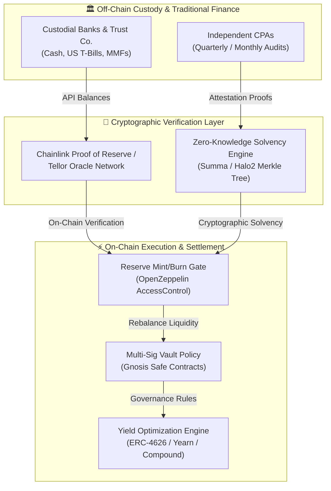

# 🌐 Awesome Automated Reserve Management in Crypto

**A curated index of enterprise SaaS solutions, algorithmic protocols, and open-source tooling for automated stablecoin reserve management, cryptographic proof-of-reserves (PoR), and on-chain treasury automation.**

  
  
  
  
  
  
  

  <b>Keywords:</b> Proof of Reserves (PoR) • Stablecoin Reserves • Automated Treasury Management • RWA Tokenization • Algorithmic Market Operations • Merkle Solvency • Collateral Oracles

---

## 📑 Table of Contents

- [📌 Introduction & Scope](#-introduction--scope)
- [📊 Sector Overview & Market Dynamics](#-sector-overview--market-dynamics)
- [🏢 SaaS & Hosted Platforms](#-saas--hosted-platforms)
- [💻 Open-Source GitHub Projects](#-open-source-github-projects)
- [🏗️ Architectural Blueprints for Reserve Systems](#️-architectural-blueprints-for-reserve-systems)
- [🤝 How to Contribute](#-how-to-contribute)
- [💖 Support](#-support)
- [📈 Star History](#--star-history)
- [⚠️ Risk Analysis & Disclaimer](#️-risk-analysis--disclaimer)

---

## 📌 Introduction & Scope

Automated reserve management represents the critical infrastructure backbone of digital asset stability. As tokenized financial instruments scale beyond fiat proxies into Real-World Assets (RWAs), algorithmic yield mechanisms, and synthetic delta-neutral derivatives, the manual tracking of vault collateral is no longer viable. 

This repository systematically indexes the ecosystem's leading **hosted SaaS platforms** and **peer-reviewed open-source frameworks** utilized by stablecoin issuers, decentralized autonomous organizations (DAOs), institutional custodians, and Web3 treasuries to accomplish:
- 🛡️ **Cryptographic Proof of Reserves (PoR):** Continuous, trust-minimized verification of off-chain bank balances and on-chain vaults using zero-knowledge proofs and Merkle sum trees.
- ⚙️ **Automated Liquidity & Collateral Sweeps:** Algorithmic rebalancing between yield-generating sovereign debt (e.g., US Treasury bills, money-market funds) and liquid redemption reserves.
- 📡 **Decentralized Oracle Attestation:** Real-time on-chain mint/burn gating tied to independent auditor and custodian data feeds.
- 🔐 **Multi-Party Treasury Custody:** Cryptographically enforced execution policies for capital allocation, automated payroll, and yield distribution.

---

## 📊 Sector Overview & Market Dynamics

> **Estimated Market Size:** The digital asset reserve management and collateralized stablecoin ecosystem currently secures over **$210+ Billion** in circulating liquidity, with institutional forecasts projecting market expansion to **$1.5 Trillion – $2.0 Trillion** by 2028–2030 as traditional cash equivalents, short-term US Treasuries, and tokenized institutional funds (e.g., BlackRock BUIDL, Franklin Templeton FOBXX) migrate on-chain.
>
> **Market Structure & Concentration:** The primary issuance tier of the sector is **highly concentrated (winner-take-most)**, with Tether (USDT) and Circle (USDC) dominating more than **85%** of aggregate market capitalization and daily transaction settlement. Conversely, the secondary infrastructure and execution layer is **moderately fragmented**, characterized by intense competitive differentiation across synthetic yield engines (Ethena), decentralized overcollateralized lending protocols (Maker/Sky, Liquity), tokenized yield-bearing debt notes (Ondo, Mountain), and modular oracle attestation services (Chainlink, Tellor, Summa).

---

## 🏢 SaaS & Hosted Platforms

The table below catalogs primary commercial and hosted platforms offering automated reserve management, stablecoin issuance infrastructure, MPC custody, and Proof-of-Reserve oracle pipelines.

> 💡 *Entries are sorted in descending order by company size (valuation, market capitalization, or annualized revenue).*

| 🏢 Platform / Provider | 📈 Company Size (Valuation / Revenue) | ⚙️ Reserve Mechanism & Category | 💳 Starting Tier Pricing | 🎁 Free Tier & Trial Limits | 🔍 Key Reserve Management Features |
| :--- | :--- | :--- | :--- | :--- | :--- |
| **[Tether (USDT)](https://tether.to/)** | **~$150B Valuation** *(~$13.0B Net Annual Profit; ~$183B Reserve Assets)* | Fiat-backed (US Treasuries, Overnight Repos, Gold, Bitcoin) | **$150 one-time** account verification fee; **0.10% redemption fee** ($1,000 minimum fee; $100,000 min order) | **Free forever public access** to real-time reserve balances, quarterly BDO attestations, and public REST API (up to 60 req/min without login) | Largest stablecoin reserve ($141B+ T-bills, $20B gold, $7B BTC); maintains an excess capital reserve buffer of over $8.2B under El Salvador DASP regulatory framework. |
| **[PayPal USD (PYUSD)](https://www.paypal.com/)** | **~$70B Market Cap** *($31.8B Annual Revenue)* | Regulated Fiat-backed (Cash Deposits & US Treasuries via Paxos Trust) | **0% fee** on USD to PYUSD conversion and transfers; **1.90% + $0.49** per transaction starting merchant checkout processing tier | **Free forever Developer Sandbox** providing 10,000 monthly simulated transactions, mock wallets, and REST API access | Regulated by the New York State Department of Financial Services (NYDFS); reserves held in short-term T-bills and cash equivalents with monthly third-party CPA attestations. |
| **[Chainlink PoR (Hosted Feeds)](https://chain.link/proof-of-reserve)** | **~$10.5B Market Cap** *($LINK Token Valuation)* | Decentralized Proof-of-Reserve Oracle Feeds & Attestation | **$500/month** base retainer for private custom enterprise reserve feeds or **$5.00 flat fee** per on-chain attestation call via Chainlink Functions | **Free forever access** across all testnets (Sepolia, Amoy, Arbitrum Testnet) with unlimited mock reserve feed calls and sample attestations | Cryptographically signed attestations bridging off-chain bank/custodian balances directly into smart contract mint/burn rules; automated circuit breaker pauses. |
| **[Circle Developer Platform (USDC)](https://www.circle.com/)** | **~$9.0B Valuation** *($1.7B Annual Revenue)* | Regulated Cash & MMF (Circle Reserve Fund / BlackRock USDXX) | **$0.020 per Monthly Active Wallet** and **$0.00025 per API call** above free tier ($5.00 monthly minimum invoice threshold) | **Free forever tier** includes the first 1,000 Monthly Active Wallets (MAWs) and first 25,000 Smart Contract Platform API calls every month | 100% backed by cash and SEC-registered government money market funds managed by BlackRock; monthly Big Four (Deloitte) assurances and daily mint/burn transparency. |
| **[Fireblocks (Treasury Automation)](https://www.fireblocks.com/)** | **~$8.0B Valuation** *($200M+ Annual Revenue)* | MPC Institutional Treasury & Reserve Operations SaaS | **$500/month** for Core Treasury Starter plan (includes MPC policy engine, AML transaction screening, and automated sweeps) | **14-day free trial** with full sandbox API access, up to 5 multi-sig testnet vault accounts, and automated transaction rule builder | Hardware-isolated multi-party computation (MPC-CMP) key infrastructure, programmatic rebalancing rules, and automated sweeping of reserve liquidity. |
| **[Ondo Finance (USDY)](https://ondo.finance/)** | **~$7.0B FDV** *($1.8B Market Cap; $600M+ TVL)* | Tokenized US Treasury Notes (RWA Yield-Bearing Reserve) | **0.15% creation/redemption fee** ($100,000 minimum mint) plus **0.50% annualized management fee** deducted from yield | **Free forever public API** and on-chain contract read calls (unlimited public queries up to 10 requests/sec for daily NAV & yields) | Overcollateralized at ~105.8%; underlying reserves held at Morgan Stanley; daily NAV yield rebasing; monthly third-party auditor reviews by Ankura Trust. |
| **[Ethena Labs (USDe)](https://ethena.fi/)** | **~$3.5B FDV** *($1.2B Market Cap; $200M+ Protocol Revenue)* | Synthetic Delta-Neutral & RWA Collateral Engine | **0.10% transaction fee** on minting/redeeming via whitelisted institutional participants ($100,000 minimum) | **Free forever public dashboard** with real-time portfolio breakdown, open Dune Analytics telemetry, and permissionless sUSDe yield staking | Backed by long spot ETH/BTC combined with short perpetual futures across major custodians (Copper, Ceffu, Cobo), liquid stablecoins, and tokenized RWAs. |
| **[Paxos Platform (USDP)](https://paxos.com/)** | **~$2.4B Valuation** *($180M Estimated Annual Revenue)* | Regulated Stablecoin Issuance & Brokerage APIs | **$2,500/month** platform fee for institutional Brokerage/Settlement API access + 0.10% trading/minting volume fee | **Free forever Developer Sandbox** with mock stablecoin minting, mock liquidity pairs, and unlimited test API calls | Qualified custodian with NYDFS trust charter; monthly KPMG assurance attestations; powers white-label reserves for PayPal, MercadoLibre, and institutional issuers. |
| **[MakerDAO / Sky (DAI / USDS)](https://sky.money/)** | **~$1.8B Market Cap** *($240M Annual Protocol Revenue)* | Overcollateralized Crypto & Institutional RWA Vaults | **3.75% variable APR** base stability fee on vault borrowing (benchmarked to Sky Savings Rate / DSR) | **Free forever access** to decentralized GraphQL subgraphs, governance portals, and permissionless read-calls on Ethereum mainnet | ~$13B collateralized debt; over $2.6B in institutional RWAs via Monetalis Clydesdale and BlockTower; automated auction liquidation and debt rebalancing engines. |
| **[Frax Finance (FRAX)](https://frax.finance/)** | **~$500M Market Cap** *($400M+ TVL)* | Hybrid Algorithmic Market Operations (AMO) & RWA | **0.20% swap fee** on Fraxswap automated reserve pools and **2.50% variable APR** starting borrow rate on Fraxlend | **Free forever access** to public Frax telemetry subgraphs, real-time collateral ratio dashboard, and documentation APIs | V3 protocol targeting ≥100% exogenous collateral; Federal Reserve IORB oracle integration; permissionless automated market operation smart contracts. |
| **[First Digital Labs (FDUSD)](https://firstdigitallabs.com/)** | **~$400M Valuation** *($3.0B FDUSD Circulating Supply)* | Segregated Fiat-Backed Reserve | **0.10% processing fee** for primary market minting/redemption ($50,000 institutional minimum) | **Free forever public portal** for downloading monthly independent attestation reports (Prescient Assurance LLC) and audit certifications | Reserves maintained in segregated, bankruptcy-remote accounts with licensed Hong Kong trust company; high-liquidity pairings on major global digital exchanges. |
| **[Mountain Protocol (USDM)](https://mountainprotocol.com/)** | **~$40M Valuation** *($150M+ TVL)* | Yield-Bearing Treasury-Backed Stablecoin | **0.10% redemption fee** on amounts below $250k; **0.25% annualized fee** deducted automatically from gross Treasury yields | **Free forever access** to real-time daily reserve attestations, Dune dashboards, and permissionless ERC-20 rebasing transfer methods | Regulated by Bermuda Monetary Authority; 100% backed by segregated short-dated US Treasuries; automatic daily rebase distributing yield directly to wallet holders. |

---

## 💻 Open-Source GitHub Projects

Explore battle-tested open-source repositories powering on-chain reserve accounting, proof-of-solvency computation, multi-sig treasury governance, and automated liquidity rebalancing.

> 💡 *Repositories are listed in descending order based on their current GitHub Star count. Click any star badge to inspect stargazers directly.*

1. **[n8n](https://github.com/n8n-io/n8n)**   
   *Fair-code workflow automation platform (Sustainable Use License)*. Extensively adopted by crypto treasuries and operations teams to automate off-chain attestation alerts, webhook-driven bank reconciliation sweeps, and multi-chain reserve health notifications.

2. **[OpenZeppelin Contracts](https://github.com/OpenZeppelin/openzeppelin-contracts)**   
   *The gold standard smart contract library for Ethereum and EVM (MIT)*. Provides foundational building blocks for reserve systems including `ERC20`, `ERC4626` (tokenized yield vaults), `AccessControl`, `Pausable`, and `MerkleProof` for cryptographic proof verification.

3. **[Chainlink Core](https://github.com/smartcontractkit/chainlink)**   
   *Decentralized oracle node software (MIT)*. Powers on-chain Proof of Reserve (PoR) feeds by querying off-chain banking APIs, custodians, and blockchain nodes to verify reserve balances before minting wrapped or pegged tokens.

4. **[Gnosis Safe Contracts](https://github.com/safe-global/safe-contracts)**   
   *Multi-signature asset management infrastructure (LGPL-3.0)*. Secures tens of billions in DAO treasuries and protocol reserve vaults through composable signature threshold policies and modular execution guards.

5. **[Compound Protocol](https://github.com/compound-finance/compound-protocol)**   
   *Algorithmic, autonomous interest rate protocol (BSD-3-Clause)*. Implements automated reserve factor accounting, collateral liquidation cascades, and dynamic interest rate curves widely utilized in stablecoin reserve yield strategies.

6. **[DefiLlama Adapters](https://github.com/DefiLlama/DefiLlama-Adapters)**   
   *Open-source protocol balance tracking SDK (MIT)*. Contains custom indexing scripts for auditing TVL, treasury compositions, and circulating reserve collateral across virtually every active DeFi protocol.

7. **[Aave v3 Core](https://github.com/aave/aave-v3-core)**   
   *Non-custodial liquidity protocol contracts (BUSL-1.1 / GPL-3.0)*. Features automated collateral reserve management, emergency administrative pauses, efficiency mode (eMode) for correlated assets, and isolated risk parameters.

8. **[Superfluid Protocol](https://github.com/superfluid-finance/protocol-monorepo)**   
   *Programmable money streaming architecture (MIT)*. Enables continuous, real-time capital allocation for treasury payroll, automated recurring reserve allocations, and continuous yield distribution without repetitive gas-heavy batch transactions.

9. **[MakerDAO DSS (Dai Stablecoin System)](https://github.com/makerdao/dss)**   
   *Core smart contracts of the DAI/USDS stablecoin (AGPL-3.0)*. The definitive architecture for multi-collateral automated reserve management, debt ceilings, stability fee accumulators, and liquidation auctions.

10. **[Celo Monorepo](https://github.com/celo-org/celo-monorepo)**   
    *Proof-of-stake layer-1 and reserve framework (Apache-2.0)*. Implements the Celo Reserve (`Mento`), an on-chain automated portfolio manager rebalancing diversified collateral (BTC, ETH, stablecoins, natural capital) to maintain algorithmic currency pegs.

11. **[Uniswap Merkle Distributor](https://github.com/Uniswap/merkle-distributor)**   
    *Merkle-tree based distribution smart contract (GPL-3.0)*. Foundational implementation pattern used in verifiable proof-of-reserve snapshots, user liability trees, and automated claims processing.

12. **[Yearn Vaults](https://github.com/yearn/yearn-vaults)**   
    *Autonomous yield-generating vault contracts (GPL-3.0)*. Standardizes ERC-4626 yield routing, automated collateral risk management, and profit harvesting mechanisms for treasury capital preservation.

13. **[Balancer v2 Monorepo](https://github.com/balancer/balancer-v2-monorepo)**   
    *Programmable asset liquidity pools (GPL-3.0)*. Offers customizable asset weightings, automated portfolio rebalancing pools, and boosted pools that route idle reserve collateral to money markets.

14. **[Liquity Protocol](https://github.com/liquity/dev)**   
    *Decentralized borrowing protocol with immutable code (MIT)*. Operates zero-interest loans against ETH collateral with instant algorithmic liquidations and an automated Stability Pool backing the LUSD peg.

15. **[Summa Solvency (Proof of Solvency)](https://github.com/summa-dev/summa-solvency)**   
    *Zero-knowledge proof-of-solvency protocol (MIT / Apache-2.0)*. Uses generalized Merkle sum trees and zk-SNARKs (Halo2) to cryptographically prove that custodial liabilities are fully covered by on-chain reserves without revealing individual user account balances.

16. **[Tellor Oracle](https://github.com/tellor-io/TellorCore)**   
    *Permissionless decentralized oracle protocol (MIT)*. Provides dispute-resistant on-chain reporting of external collateral valuations, spot reserve prices, and off-chain audit attestations.

---

## 🏗️ Architectural Blueprints for Reserve Systems

When engineering custom, production-grade reserve management solutions, protocol architects typically integrate modular open-source layers:

### Reference Implementation Stack:
1. **Core Token & Vault Logic:** Use [OpenZeppelin Contracts](https://github.com/OpenZeppelin/openzeppelin-contracts) for `ERC20`, `ERC4626` yield vaults, and `AccessControl`.
2. **Oracle Attestation:** Integrate [Chainlink Proof of Reserve](https://github.com/smartcontractkit/chainlink) to feed cryptographic reserve levels into smart contract mint triggers.
3. **Multi-Sig Custody:** Route operational permissions through [Gnosis Safe](https://github.com/safe-global/safe-contracts) with time-locks and execution guards.
4. **Verifiable Proof of Solvency:** Implement [Summa Solvency](https://github.com/summa-dev/summa-solvency) for zk-SNARK based user liability reconciliation.
5. **Operational Automation:** Deploy [n8n](https://github.com/n8n-io/n8n) workflows for automated off-chain monitoring, Discord/Slack alerting, and reconciliation reporting.

---

## 🤝 How to Contribute

We actively welcome contributions from stablecoin developers, treasury managers, and crypto researchers!

1. 🍴 **Fork the Repository:** Create a personal fork on GitHub.
2. 🌿 **Create a Feature Branch:** `git checkout -b feat/add-reserve-platform`
3. 📝 **Add or Update Entries:** Ensure entries adhere to our directory schema:
   - Provide exact name, website, and repository links.
   - For SaaS products, include verifiable starting prices and explicit free tier or trial parameters (no generic placeholders).
   - For open-source tools, include the repository's social star badge linked to `/stargazers`.
4. 🧪 **Validate Formatting:** Verify markdown rendering and alphabetical/numerical sort ordering.
5. 🚀 **Submit a Pull Request:** Detail your rationale and include primary source documentation (e.g., audit links, pricing pages).

---

## 💖 Support

A huge **thank you** for exploring and utilizing this curated directory! If you find this resource valuable for your research, protocol development, or crypto treasury operations:

- 🌟 **Star this repository** to support ongoing updates and help others discover it.
- 🍴 **Fork and contribute** your favorite automated reserve protocols, audit frameworks, or research tools.
- 📢 **Share it** with fellow crypto engineers, DAO treasurers, and Web3 finance teams.
- ☕ **Buy me a coffee / sponsor:** If you would like to support ongoing development and maintenance, consider sponsoring via the [Sponsor Dashboard](https://github.com/sponsors/ishandutta2007).

  
  

---

##  Star History

---

## ⚠️ Risk Analysis & Disclaimer

> [!WARNING]
> **Regulatory and Operational Considerations:**
> - **Attestation vs. Full Financial Audit:** A Proof-of-Reserve attestation only verifies that a specific set of addresses or bank accounts held sufficient balances at a single discrete point in time. It does **not** evaluate undisclosed liabilities, off-balance-sheet commitments, internal fraud controls, or operational solvency.
> - **Counterparty & Custodial Exposure:** Real-World Asset (RWA) and fiat-backed stablecoins inherit the legal, operational, and jurisdictional counterparty risks of their traditional banking partners, custodians, and asset managers.
> - **Algorithmic & Smart Contract Vulnerabilities:** Autonomous rebalancing strategies, automated market operations (AMOs), and synthetic derivative hedges (such as basis funding rates) can experience systemic failure during severe market volatility or liquidity decoupling.
> - **Informational Purpose Only:** This repository is maintained strictly for developer educational, research, and technical indexing purposes. Nothing in this repository constitutes investment, financial, legal, or regulatory advice.

---

  Maintained by the open-source Web3 community • Contributions and additions are always welcome!

